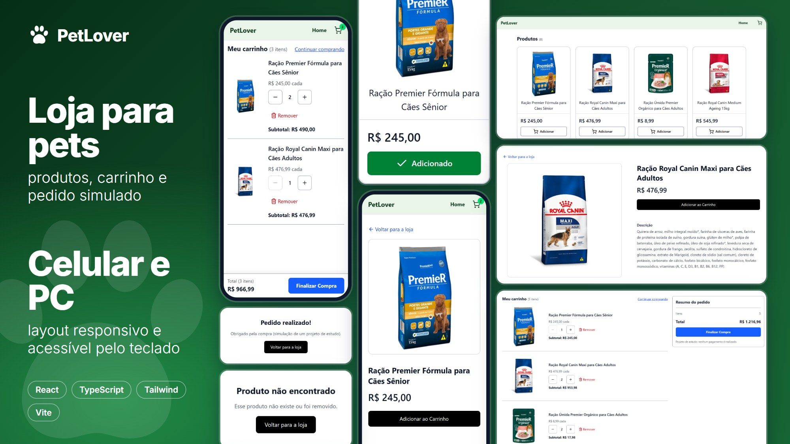
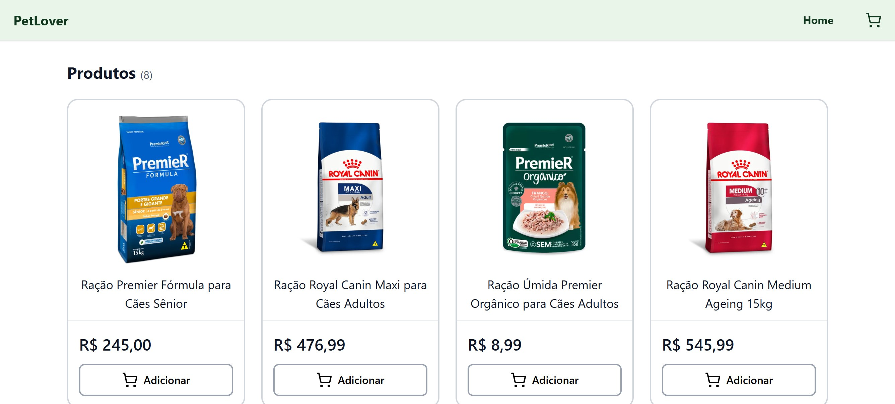
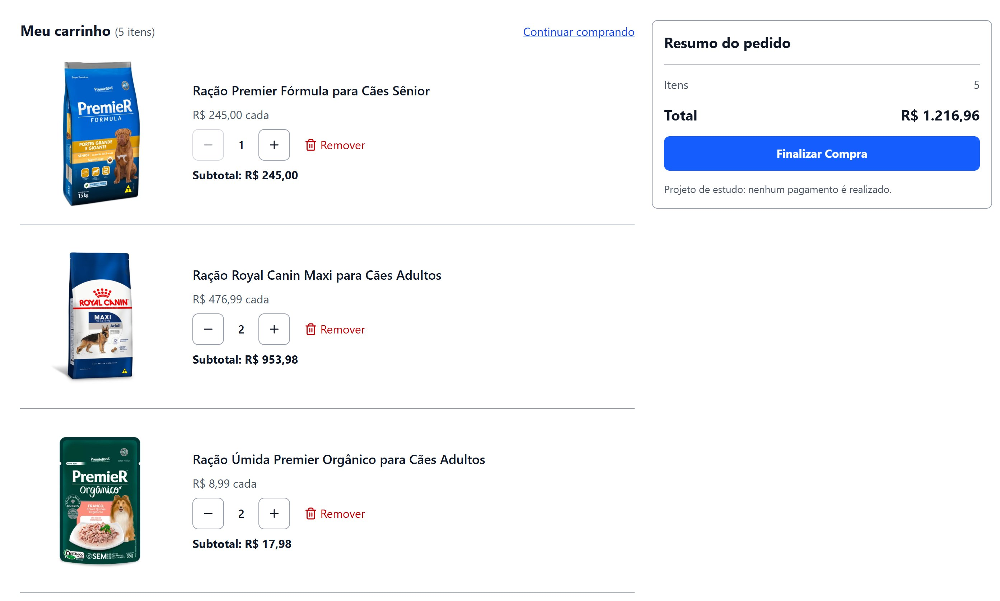
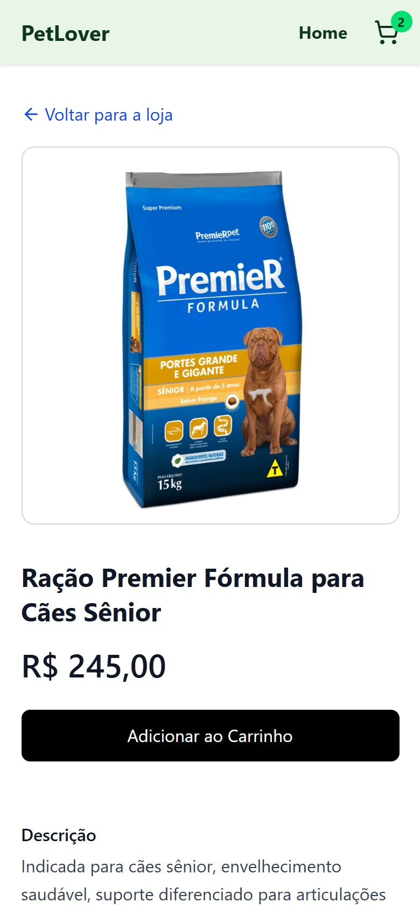

<h1 align="center">🐾 Pet Shop</h1>

<p align="center"><em>Loja de produtos para pets com carrinho, quantidade e finalização de pedido simulada.</em></p>

<p align="center">
  
</p>

<p align="center">
  <a href="https://pet-shop-wheat-delta.vercel.app"><strong>🔗 Ver online</strong></a> ·
  <a href="#-sobre">Sobre</a> · <a href="#-funcionalidades">Funcionalidades</a> · <a href="#-tecnologias">Tecnologias</a> · <a href="#-como-rodar">Como rodar</a> · <a href="#-contato">Contato</a>
</p>

<p align="center">
  
  
  
</p>

---

## 💻 Sobre

Uma loja virtual de produtos para pets que fiz para estudar React com TypeScript. Depois, revisei o carrinho e a interface para funcionarem bem no celular e no computador.

> **Tipo:** projeto de estudo · **Ano:** 2026 · **Online:** [pet-shop-wheat-delta.vercel.app](https://pet-shop-wheat-delta.vercel.app)

## ✨ Funcionalidades

- Lista de produtos e página de detalhes de cada um.
- Carrinho com quantidade, total e opção de remover itens.
- Finalização de pedido simulada, sem pagamento real.
- Funciona no celular e no PC, e dá para usar só com o teclado.

## 🎯 Dores que resolve

- Ver os produtos e os preços de forma clara, em qualquer tela.
- Saber quanto vai pagar antes de finalizar a compra.

## 💼 Tecnologias


| Tecnologia | Para que usei |
| --- | --- |
| **React** | Interface em componentes. |
| **TypeScript** | Tipagem de produtos e carrinho. |
| **React Router** | Rotas da loja, do produto e do carrinho. |
| **Context API** | Estado do carrinho compartilhado entre as telas. |
| **Tailwind CSS** | Estilo e layout responsivo. |
| **Vite** | Ambiente de desenvolvimento e build. |

## 📸 Telas

<table>
  <tr>
    <td width="33%" align="center" valign="top"><br /><sub>Lista de produtos</sub></td>
    <td width="33%" align="center" valign="top"><br /><sub>Carrinho com total</sub></td>
    <td width="33%" align="center" valign="top"><br /><sub>Produto no celular</sub></td>
  </tr>
</table>

## 🚀 Como rodar

Precisa do Node.js e do npm instalados.

```bash
git clone https://github.com/MuriloRocha-01/Pet-shop-Stude-React.git
cd Pet-shop-Stude-React
npm install
npm run dev        # abre em http://localhost:5173
```

Outros comandos: `npm run build` (gera a pasta `dist`), `npm run preview` (testa o build) e `npm run lint`.

## 🗂 Estrutura do projeto

```text
src/
├─ components/   cabeçalho, rodapé e layout
├─ context/      estado do carrinho (Context API)
├─ data/         produtos (dados locais, sem servidor)
├─ page/         home, produto e carrinho
├─ notfound/     página de produto não encontrado
├─ services/     acesso aos produtos
├─ types/        tipos do produto e do carrinho
└─ utils/        formatação de preço
vercel.json      manda todas as rotas para o index.html (React Router)
```

## 📚 O que aprendi

- ✅ Gerenciar o estado global do carrinho com Context API.
- ✅ Atualizar o estado sem duplicar produto em cliques rápidos.
- ✅ Criar rotas com React Router, inclusive a página de produto não encontrado.
- ✅ Fazer layout responsivo com Tailwind para celular e PC.
- ✅ Cuidar de UX: aviso ao adicionar, botões de 44 px e foco visível no teclado.
- ✅ Trocar um servidor de mentira (json-server) por dados locais para publicar na Vercel.

## 🧭 Próximos passos

- [ ] Guardar o carrinho no navegador (localStorage): hoje ele zera ao recarregar a página
- [ ] Busca e filtros por categoria
- [ ] Baixar as imagens dos produtos para a pasta public (hoje vêm de um site externo)
- [ ] Pagamento real no lugar do pedido simulado

## 📬 Contato

Disponível para freelas e novas oportunidades, **#OpenToWork** 🚀  
📧 [murilorochadelima.10@gmail.com](mailto:murilorochadelima.10@gmail.com) · 💼 [LinkedIn](https://www.linkedin.com/in/murilo-rocha-6706a41aa/) · 🐙 [GitHub](https://github.com/MuriloRocha-01) · 🌐 [Portfólio](https://oficial-portifolio-six.vercel.app)

---

<p align="center">Feito com 💙 por <a href="https://github.com/MuriloRocha-01">Murilo Rocha</a></p>
